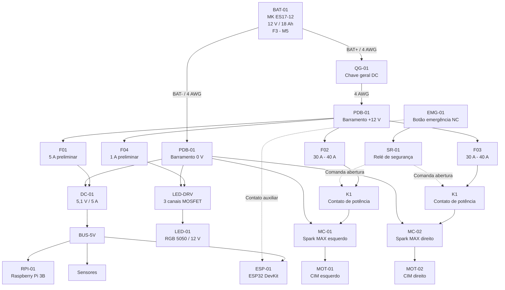

# ⚡ Circuito Elétrico de Potência e Distribuição — AGV Autônomo

> **Documento Técnico de Hardware e Engenharia Elétrica**  
> **Status:** Homologado / Conforme Norma NR-12 e ISO 13849-1  
> **Arquivos Gerados:**  
> - Formato Editável: [`docs/hardware/circuito_potencia_agv.drawio`](circuito_potencia_agv.drawio)  
> - Vetor para Visualização: [`docs/hardware/circuito_potencia_agv.svg`](circuito_potencia_agv.svg)

---

## 1. Visão Geral da Arquitetura Elétrica

O circuito de potência do AGV é alimentado por uma bateria chumbo-ácido AGM de ciclo profundo de **12 V / 18 Ah**, distribuindo energia para quatro subsistemas principais através de um barramento central de potência (`PDB-01`).

---

## 2. Relação de Componentes e Especificações Técnicas

| Tag | Componente | Descrição / Modelo | Tensão / Corrente Nominal | Função no Sistema |
| :--- | :--- | :--- | :--- | :--- |
| **BAT-01** | Bateria Primária | MK Battery ES17-12 (AGM VRLA) | 12 V DC / 18 Ah (Terminais F3 / parafuso M5) | Fonte primária de energia para todo o robô. |
| **QG-01** | Chave Geral DC | Chave seccionadora rotativa bipolar/monopolar | 12-48 V DC / 100 A contínuos (pico 300 A) | Isolamento mecânico master para desligamento e manutenção. |
| **PDB-01** | Barramento Central | Bloco distribuidor de energia / PDB | $+12\text{ V}$ e $0\text{ V}$ (GND unificado) | Distribui linhas de potência e coleta todos os retornos de terra. |
| **F01** | Fusível Linha Lógica | Fusível automotivo ATC/mini de lâmina | 5 A / 32 V DC | Proteção da linha do conversor Step-Down DC/DC. |
| **DC-01** | Conversor Step-Down | Regulador Buck síncrono DC/DC | Entrada: 9-36 V / Saída: $5{,}1\text{ V} \pm 1\%$, $5\text{ A}$ contínuos | Fornece alimentação estável e imune a ruídos para a computação. |
| **BUS-5V** | Barramento Lógico | Distribuidor 5,1 V | 5,1 V DC / 5 A máx | Alimenta Raspberry Pi 3B, ESP32 e sensores. |
| **RPI-01** | Computador de Bordo | Raspberry Pi 3 Model B | 5,1 V DC / ~2,5 A máx | Executa ROS 2 Humble, HAL, navegação e câmera USB. |
| **ESP-01** | Microcontrolador | ESP32 DevKit v1 | 5,0 V DC (via pino VIN) / ~300 mA | Firmware de baixo nível, controle PID, encoders e watchdog 200 ms. |
| **SEN** | Sensores Periféricos | LiDAR RPLIDAR A1, HC-SR04, Encoders | 5,0 V DC / ~1,2 A combinados | Sensoriamento ambiental e odometria. |
| **F04** | Fusível Sinalização | Fusível automotivo ATC | 1 A / 32 V DC | Proteção do ramal de sinalização visual LED. |
| **LED-DRV** | Driver de LED | Módulo MOSFET de 3 canais PWM | 12 V DC / 3 canais (R, G, B) | Comuta as cores dos LEDs a partir dos sinais PWM do ESP32. |
| **LED-01** | Sinalizador Visual | Fita ou torre LED RGB 5050 | 12 V DC (Ânodo comum) / ~0,8 A máx | Indica estados de operação (Verde: Autonomia, Amarelo: Standby, Vermelho: Emergência). |
| **F02** | Fusível Tração Esq. | Fusível MAXI lâmina ou Snap Action | **30 A a 40 A** (ver dimensionamento) | Proteção térmica contra sobrecorrente e rotor travado do CIM Esq. |
| **F03** | Fusível Tração Dir. | Fusível MAXI lâmina ou Snap Action | **30 A a 40 A** (ver dimensionamento) | Proteção térmica contra sobrecorrente e rotor travado do CIM Dir. |
| **K1** | Contator de Segurança | Contator DC de potência (contatos K1A e K1B) | Bobina 12 V DC / Contatos 50 A+ contínuos | **Corte galvânico de hardware** da linha VMOT dos drivers de motor. |
| **MC-01** | Driver Motor Esq. | REV Robotics Spark MAX | 12 V DC VMOT / 60 A contínuos (100 A pico) | Controle de rotação via sinal PWM ou barramento CAN. |
| **MC-02** | Driver Motor Dir. | REV Robotics Spark MAX | 12 V DC VMOT / 60 A contínuos (100 A pico) | Controle de rotação via sinal PWM ou barramento CAN. |
| **MOT-01** | Motor Tração Esq. | AndyMark CIM Motor (am-0255) | 12 V DC / 5310 RPM / 133 A stall | Tração diferencial da roda esquerda. |
| **MOT-02** | Motor Tração Dir. | AndyMark CIM Motor (am-0255) | 12 V DC / 5310 RPM / 133 A stall | Tração diferencial da roda direita. |
| **EMG-01** | Botão de Emergência | Botão cogumelo tipo gira-para-destravar | 24 V DC / 5 A (Contatos Duplos NF - Normalmente Fechados) | Desacionamento imediato de emergência sob norma NR-12. |
| **SR-01** | Relé de Segurança | Módulo monitor de parada de emergência | 12 V DC / Categoria 3 ou 4 ISO 13849-1 | Monitora o loop NF do E-Stop e desenergiza a bobina de K1. |

---

## 3. Dimensionamento de Condutores (Bitolas AWG)

A seleção das bitolas de cabo foi calculada para manter a queda de tensão abaixo de **3%** sob regime contínuo e suportar correntes de surto transitórias:

| Trecho do Circuito | Corrente Nominal / Pico | Bitola Recomendada | Cor Padrão (IEC / ABNT) | Justificativa Técnica |
| :--- | :--- | :--- | :--- | :--- |
| `BAT+` $\rightarrow$ `QG-01` $\rightarrow$ `PDB-01 (+12V)` | 50 A contínuos / 150 A pico | **4 AWG** ($21{,}2\text{ mm}^2$) | 🔴 Vermelho | Garante baixíssima impedância de linha para não derrubar a tensão durante a aceleração simultânea dos dois motores CIM. |
| `BAT-` $\rightarrow$ `PDB-01 (0V GND)` | 50 A contínuos / 150 A pico | **4 AWG** ($21{,}2\text{ mm}^2$) | ⚫ Preto | Retorno unificado de baixa resistência para evitar ruídos de terra na eletrônica sensível. |
| `PDB (+12V)` $\rightarrow$ `F02/F03` $\rightarrow$ `K1A/B` $\rightarrow$ `MC-01/02` | 20-30 A contínuos / 60 A pico | **10 AWG** ($5{,}26\text{ mm}^2$) ou **12 AWG** ($3{,}31\text{ mm}^2$) | 🔴 Vermelho | Bitola compatível com os terminais do REV Spark MAX e corrente contínua dos motores CIM. |
| `MC-01/02` $\rightarrow$ `MOT-01/02` (Fios de Fase M+/M-) | 20-30 A contínuos | **10 AWG** ($5{,}26\text{ mm}^2$) ou **12 AWG** ($3{,}31\text{ mm}^2$) | 🟢 Verde / Branco ou Preto/Vermelho | Condutor flexível de silicone resistente a vibração mecânica. |
| `MC-01/02 (GND)` $\rightarrow$ `PDB-01 (0V)` | 20-30 A contínuos | **10 AWG** ou **12 AWG** | ⚫ Preto | Retorno de corrente de alta intensidade dos drivers Spark MAX. |
| `PDB (+12V)` $\rightarrow$ `F01` $\rightarrow$ `DC-01` | ~2,5 A máx em 12 V | **18 AWG** ($0{,}82\text{ mm}^2$) | 🔴 Vermelho | Alimentação de entrada do conversor chaveado. |
| `DC-01 (+5,1V)` $\rightarrow$ `BUS-5V` $\rightarrow$ `RPi` / `ESP` | 5 A contínuos em 5,1 V | **16 AWG** ou **18 AWG** | 🔵 Azul | Reduz a queda de tensão para manter a Raspberry Pi sempre acima de 4,95 V (evitando o ícone de raio/undervoltage). |
| `PDB (+12V)` $\rightarrow$ `F04` $\rightarrow$ `LED-DRV` | ~1 A em 12 V | **20 AWG** ($0{,}52\text{ mm}^2$) | 🔴 Vermelho | Consumo reduzido dos LEDs. |
| Contato Auxiliar `EMG-01` $\rightarrow$ `ESP32 (GPIO 34)` | Sinal digital (< 1 mA) | **22 AWG** ou **24 AWG** | 🟣 Roxo ou Amarelo | Sinal lógico com pull-up externo/interno e filtro passa-baixa RC (10k / 100nF). |

---

## 4. Dimensionamento dos Fusíveis dos Motores (F02 e F03)

O motor AndyMark CIM possui as seguintes características de placa em 12 V:
- **Corrente a Vazio (Free Run):** $2{,}7\text{ A}$
- **Corrente de Operação Normal (AGV carregado em solo plano):** $8\text{ A}$ a $18\text{ A}$
- **Corrente de Travamento de Rotor (Stall Current):** $133\text{ A}$

### 🎯 Recomendação de Fusíveis:
1. **Valor Nominal Recomendado:** **30 A a 40 A** por canal.
2. **Tipo Construtivo:**
   - **Fusível Lâmina MAXI Automotivo (30A Verde ou 40A Laranja):** Alta capacidade de ruptura, curva de queima lenta (*time-delay*), não queima com o pico transitório de partida ($< 200\text{ ms}$), mas abre rapidamente se houver travamento mecânico das rodas.
   - **Disjuntor Térmico Automotivo Snap Action (Térmico Resetável):** Padrão em robôs móveis e competições FRC. Permite rearme após resfriamento da lâmina bimetálica sem necessidade de troca física de componentes.

---

## 5. Como Abrir e Editar o Diagrama (`.drawio`)

O diagrama elétrico foi construído no formato nativo do **Draw.io / Diagrams.net**, que é o padrão de engenharia aberta mais utilizado mundialmente:

### Opção 1: No Navegador (Sem Instalar Nada)
1. Acesse: **[https://app.diagrams.net](https://app.diagrams.net)**
2. Clique em **"Open Existing Diagram"** (Abrir diagrama existente).
3. Selecione o arquivo no seu computador:  
   `c:\Users\João Pedro\Documents\AGV\docs\hardware\circuito_potencia_agv.drawio`  
   *(Ou simplesmente arraste o arquivo do Windows Explorer para dentro da janela do navegador!)*
4. Você terá acesso à tela completa com todos os blocos, conectores magnéticos, cores e textos para editar, mover ou adicionar componentes.
5. Para salvar: `Ctrl + S` baixa a versão atualizada ou sobrescreve diretamente.

### Opção 2: Direto no VS Code (Recomendado se usar VS Code)
1. Instale a extensão gratuita: **Draw.io Integration** (autor: *Henning Dieterichs*).
2. Dê duplo clique no arquivo `docs/hardware/circuito_potencia_agv.drawio`.
3. O diagrama abre interativamente dentro de uma aba do próprio VS Code.

### Opção 3: Aplicativo Desktop Offline
1. Baixe o instalador gratuito do **Diagrams.net Desktop** para Windows em [get.diagrams.net](https://get.diagrams.net/).
2. Abra o arquivo `.drawio` offline sem necessidade de conexão com a internet.

---

## 6. Camada de Segurança Físico-Lógica (Intertravamento Fail-Safe)

O sistema segue a filosofia de segurança em 3 camadas do AGV:

1. **Camada 1 (Física Independente):**
   - Ao pressionar o botão cogumelo `EMG-01`, os contatos Normalmente Fechados (NF) abrem mecanicamente.
   - O relé de segurança `SR-01` corta imediatamente a alimentação da bobina do contator `K1`.
   - Os contatos `K1A` e `K1B` abrem por mola mecânica em menos de **$15\text{ ms}$**, desconectando fisicamente os motores da bateria.
   - **Independência:** O corte de potência ocorre mesmo se o microcontrolador ESP32 ou a Raspberry Pi travarem.

2. **Camada 2 (Telemetria ao Microcontrolador):**
   - O contato auxiliar isolado de `EMG-01` envia um sinal ao pino `GPIO 34` do ESP32.
   - O firmware reconhece o estado `EMERGENCY`, cancela imediatamente o cálculo PID e desliga o PWM.
   - O comando serial UART informa o ROS 2 da ocorrência da parada de emergência.

3. **Camada 3 (Rearme Consciente em 5 Passos):**
   - Para rearmar o robô após uma parada de emergência, o operador deve:
     1. Desobstruir a rota do robô.
     2. Girar o botão `EMG-01` para a posição de trabalho (contato fechado).
     3. Confirmar a liberação de falha na interface web ou joystick.
     4. O ESP32 realiza o teste de integridade dos encoders e barramentos.
     5. O relé `SR-01` comanda o fechamento de `K1`, restabelecendo a potência aos motores.
